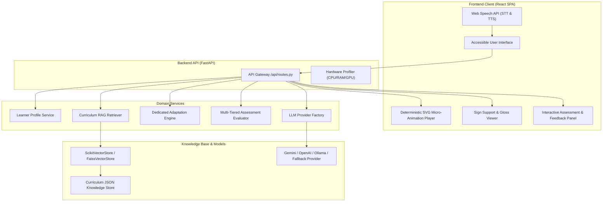

# System Architecture

## 1. Architectural Philosophy

The architecture of the **Multimodal Adaptive Generative AI Tutor** adheres to four core tenets:

1. **Accessibility First:** Accessibility requirements are first-class architectural constraints, not post-processing filters.
2. **Pedagogical Grounding:** Content generation is strictly grounded in verified curriculum knowledge documents through a Retrieval-Augmented Generation (RAG) pipeline to prevent hallucination.
3. **Decoupled Adaptation Engine:** Adaptation logic is centralized in a dedicated module (`backend/app/services/adaptation/engine.py`) rather than being scattered across UI components or prompt strings.
4. **Deterministic Lightweight Efficiency:** Core micro-animations and vector search are engineered to execute on standard laptop hardware (Intel Core i5 / integrated GPU / 8–16 GB RAM) with sub-second response latency and 100% offline fallback readiness.

---

## 2. Component Diagram

---

## 3. Subsystem Deep Dive

### A. Learner Profile & Accessibility Requirements
- **Model:** `LearnerProfile` (`backend/app/models/domain.py`)
- **Key Fields:** `learner_type`, `accessibility_requirements`, `preferred_input`, `preferred_output`, `learning_history`, `assessment_history`, `adaptation_history`.
- **Profiles:**
  - `deaf_demo_learner`: Requires visual explanations, clear text captions, sign-language gloss support, and audio-optional interaction.
  - `down_syndrome_demo_learner`: Requires simplified sentence structure, micro-learning steps (1-idea at a time), visual storytelling, and comforting reinforcement.

### B. Curriculum Knowledge Base & RAG Pipeline
- **Directory:** `backend/app/data/curriculum/`
- **Data Schema:** Each concept file includes `standard_explanation`, `simplified_explanation`, `key_points`, `examples`, `misconceptions`, `visual_scenes`, `sign_glossary`, and `assessment_questions`.
- **Chunking:** `DocumentProcessor` partitions each file into typed semantic chunks.
- **Indexing:** `ScikitVectorStore` computes sublinear TF-IDF vectors with n-gram character/word analysis and cosine similarity. It consumes under 2 MB RAM and answers top-k queries in < 2ms.

### C. Dedicated Adaptation Engine
- **Module:** `backend/app/services/adaptation/engine.py`
- **Inputs:** `LearnerProfile`, target `concept`, `is_correct`, `attempt_number`, `current_representation`.
- **Adaptation Actions:**
  - `CONTINUE`: On correct answer, consolidates mastery and progresses to next concept.
  - `SIMPLIFY`: Decomposes multi-step explanation into 3 ultra-short micro-steps.
  - `MORE_VISUAL`: Emphasizes visual cards and diagrammatic flow.
  - `STEP_BY_STEP`: Annotates individual sub-steps with sign-gloss descriptions.
  - `ALTERNATIVE_EXAMPLE`: Introduces a grounded real-world analogy (e.g., cooking in a kitchen or drinking glass) to resolve misconceptions.
  - `MICRO_LESSON`: Atomic 1-element visual spotlight.

### D. Multi-Tiered Assessment Evaluation
- **Module:** `backend/app/services/assessment/evaluator.py`
- **Evaluation Pipeline:**
  1. **Tier 1 (Exact Match):** Normalized exact string match.
  2. **Tier 2 (Synonym / Abbreviation Match):** Maps scientific terminology (e.g. `CO2` ↔ `carbon dioxide`, `O2` ↔ `oxygen`, `H2O` ↔ `water`).
  3. **Tier 3 (Substring Match):** Captures conversational answers containing the target term.
  4. **Tier 4 (Semantic Similarity):** Character n-gram TF-IDF cosine similarity scoring.

### E. Deterministic Educational Micro-Animation Subsystem
- **Module:** `backend/app/services/animation/scene_generator.py` and `frontend/src/components/MicroAnimationPlayer.jsx`
- **Rationale:** Unconstrained text-to-video models require massive GPU VRAM (12–24 GB) and produce non-deterministic, flickering artifacts. Our deterministic SVG scene engine guarantees consistent, pedagogical, step-by-step visual storytelling that runs at 60 FPS on any browser with cognitive pacing controls (`0.5x`, `0.75x`, `1.0x`).

### F. Universal Curriculum Knowledge Synthesizer (Open-Domain Guarantee)
- **Module:** `backend/app/services/rag/universal_synthesizer.py`
- **Rationale:** Rather than being restricted to a static set of pre-seeded topics, the system features a **Universal Curriculum Synthesizer** that can ingest and dynamically formulate a structured educational representation for **ANY query asked**:
  - Automatically identifies subject domain (Physics, Chemistry, Biology, Mathematics, Earth Science, Early Learning).
  - Infers appropriate cognitive tier from Montessori through 10th Grade CBSE.
  - Generates standard scientific explanations, Down syndrome visual storytelling analogies, 4 key points, sequential visual SVG animation scenes, ASL/ISL sign-gloss cards, and interactive assessment questions.
  - Persists new topics and re-indexes the vector store on the fly so the tutor continuously expands its knowledge base.

### G. Montessori to 10th Grade CBSE Curriculum Hierarchy
- **Tier 1 — Montessori & Early Childhood (Ages 3–6 / KG):**
  - `shapes_and_colors.json`: Round circles, 4-sided squares, 3-cornered triangles, primary colors.
  - `counting_numbers_1_to_10.json`: 1-to-1 correspondence, counting apples into baskets.
- **Tier 2 — Primary School (CBSE Grades 1–5):**
  - `photosynthesis.json`: Sun, water, leaves, chloroplast food factory, oxygen release.
  - `water_cycle.json`: Evaporation, condensation, precipitation, collection.
  - `fractions.json`: Whole pizza, halves (1/2), quarters (1/4), fair sharing.
  - `states_of_matter.json`: Solid ice, liquid water, gas steam.
  - `solar_system.json`: Central sun, planetary orbits, lunar cycles.
  - `gravity_and_falling_objects.json`: Earth's invisible pull, falling objects.
- **Tier 3 — Middle School (CBSE Grades 6–8):**
  - `magnets_and_magnetism.json`: North/South poles, magnetic field, attraction, repulsion.
  - `acids_bases_and_salts.json`: Lemons vs soap, litmus indicator test (blue ↔ red), neutralization.
- **Tier 4 — Secondary School (CBSE Grades 9–10):**
  - `human_circulatory_system.json`: 4 heart chambers, double circulation, arteries, veins, pulmonary circuit.
  - `electricity_and_ohms_law.json`: Voltage, current, resistance ($V = I \cdot R$), series circuits.
  - `trigonometry_basics.json`: Right-angled triangles, Hypotenuse, $\sin(\theta)$, $\cos(\theta)$, $\tan(\theta)$, indirect height measurement.

### H. Spatial Concept Mind Map Architecture
- **Component:** `frontend/src/components/ConceptMindMap.jsx` & `LessonDisplay.jsx`
- **Design:** Implements an interactive SVG node-link relational diagram that decomposes concepts into 5 spatial pedagogical anchors:
  1. **Central Idea:** Core scientific/mathematical concept.
  2. **Foundation Inputs:** Essential starting materials/energy (e.g., Sunlight, Water, Voltage).
  3. **Active Mechanism:** The core transformation or biological function.
  4. **Result & Output:** Products formed or forces produced (e.g., Glucose, Oxygen, Current).
  5. **Real-World Metaphor:** Daily life connection grounding the abstraction.
- Includes Web Speech API node audio synthesis and high-contrast toggle compliance.

### I. Custom Learner Profile Management
- **Components:** `frontend/src/components/CustomLearnerModal.jsx`, `LearnerProfileSelector.jsx`, and `backend/app/services/learner/profile_service.py`
- **Capabilities:** Allows educators and parents to author custom learner personas with:
  - Custom cognitive pacing speeds (`0.5x`, `0.75x`, `1.0x`)
  - Target curriculum tiers (Montessori, Primary, Middle, Secondary CBSE)
  - Granular accessibility toggles (`audio_optional`, `captions_enabled`, `simple_language`, `micro_learning`, `repetition_support`)
  - Dynamic persistence via `POST /api/learners` and immediate UI card activation.

### J. Longitudinal Analytics & Certificate Engine
- **Component:** `frontend/src/components/StudentAnalyticsDashboard.jsx`
- **Features:**
  - Tracks total assessments, accuracy rate, and chronological adaptation state triggers.
  - Displays host empirical verification benchmarks (retrieval latency, scoring accuracy, RSS footprint).
  - Generates an official, printable **Certificate of Inclusive Learning Mastery** with verified milestone badges, token verification, and print styling.

### K. Examiner Viva Defense Tour
- **Component:** `frontend/src/components/VivaTourModal.jsx` & `Navbar.jsx`
- **Rationale:** Provides an examiner-ready quick launch bar allowing review committees to immediately trigger live test scenarios for Deaf representation, Down syndrome micro-learning, CBSE 10th Ohm's law with Concept Mind Map, Montessori counting, open-domain query synthesis, and analytics verification.

### L. Edge Networking & Dual-Stack Binding
- **Configuration:** Uvicorn binds to `0.0.0.0:8000` with dual-stack IPv4/IPv6 support to prevent Windows 11 `::1` localhost resolution drops, allowing direct access from both `http://localhost:8000` and `http://127.0.0.1:8000`.
